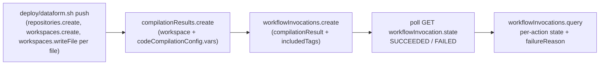

# Dataform engine — bronze → silver (NetSuite)

Standalone Dataform core 3.x project that turns the all-STRING NetSuite bronze tables into typed,
deduplicated silver tables, following [docs/CONVENTIONS.md](../docs/CONVENTIONS.md). It is pushed to a
Dataform repository **without a git connection** (files are uploaded into a workspace through the
REST API) and executed through `compilationResults` + `workflowInvocations` — exactly the surface the
Airflow orchestrator uses.

## Layout

```
dataform/
  workflow_settings.yaml                  defaults (ani-labs) + vars udp_project/bronze_dataset/silver_dataset/run_id
  includes/netsuite.js                    tf_to_bool, ns_date, ns_timestamp, ns_numeric, ns_int, json_ref_id,
                                          latest_version (dedupe CTE), audit_columns (_silver_loaded_at/_silver_run_id)
  definitions/00_sources/*.sqlx           declarations for bronze netsuite_account/transaction/transactionline/budgets
  definitions/01_silver/netsuite/
    stg_netsuite_account.sqlx             table        latest version per id, typed, subsidiary_id from JSON
    stg_netsuite_transaction.sqlx         incremental  MERGE on id, watermark MAX(_bronze_ingested_at)
    fct_netsuite_transaction_lines.sqlx   table        detail lines (mainline='F') ⋈ posting txns; partition trandate, cluster account
    agg_netsuite_posting_daily.sqlx       table        per trandate/account/subsidiary totals from the fact
    stg_netsuite_budgets_monthly.sqlx     table        UNPIVOT amount_1..12 -> one row per budget_id/month
../deploy/dataform.sh                     push | compile | run <tag> [run_id] | status <invocation>
../tests/dataform/test_project.py         offline structural checks (pytest, no Dataform CLI)
```

Conventions implemented in every model:

* `database`/`schema` come from `dataform.projectConfig.vars.udp_project` / `.silver_dataset`;
  bronze is referenced as `${ref(dataform.projectConfig.vars.bronze_dataset, "netsuite_x")}` with a
  matching declaration, so the orchestrator can repoint datasets purely through compilation `vars`.
* Dedupe rule: `latest_version()` keeps one row per id, latest `ingestion_timestamp`, tie-break on the
  parsed `lastmodifieddate` (`linelastmodifieddate` for lines).
* Audit columns: `_silver_loaded_at = CURRENT_TIMESTAMP()`, `_silver_run_id = 'dataform:<run_id var>'`
  (`'dataform:dataform'` when the orchestrator does not pass `run_id`).
* Tags: `["netsuite", "silver", "<output table>"]`. Dataform core 3 auto-assertions inherit the
  table's tags, so `includedTags: ["<table>"]` runs the table **and** its assertions.
* Type conversions: `'T'/'F' -> BOOL`, `M/D/YYYY -> DATE`, `M/D/YYYY H:MM:SS AM -> TIMESTAMP`,
  money `-> NUMERIC`, counts `-> INT64`; `id` columns stay STRING.
* Idempotency: `type: table` = CREATE OR REPLACE; `stg_netsuite_transaction` is `type: incremental`
  with `uniqueKey: ["id"]` (BigQuery MERGE). Incremental runs only read bronze rows with
  `ingestion_timestamp > MAX(_bronze_ingested_at)` of the existing table, deduped before merging, so a
  re-run with no new bronze data changes nothing (verified: 1500 rows / 1500 ids after two runs).

## GCP objects (ani-labs)

| Thing | Value |
|---|---|
| Repository | `projects/ani-labs/locations/us-central1/repositories/bronze-to-silver` |
| Workspace | `projects/ani-labs/locations/us-central1/repositories/bronze-to-silver/workspaces/labs` |
| Silver dataset / assertions | `ani-labs.elementl_silver` / `ani-labs.elementl_silver_assertions` |
| Invocation service account | `5473845300-compute@developer.gserviceaccount.com` (see "Gotchas") |

## Flow



```bash
deploy/dataform.sh push                       # idempotent: creates repo/workspace if missing, re-uploads files
deploy/dataform.sh compile                    # prints compilation errors (exit 2) and the action list with tags
deploy/dataform.sh run stg_netsuite_account   # compile + invoke by tag + poll + per-action status
deploy/dataform.sh run stg_netsuite_transaction manual__2026-10-07   # second arg = run_id var
deploy/dataform.sh status <invocation id or full name>
```

Pushing is a plain `writeFile` per project file (`workflow_settings.yaml`, `definitions/**`,
`includes/**`); no `installNpmPackages` is required because `workflow_settings.yaml` pins
`dataformCoreVersion: 3.0.69`. After editing SQLX just `push` again and re-`compile` (writeFile overwrites).

## Exact API payloads for the orchestrator

Base URL `https://dataform.googleapis.com/v1beta1`, bearer = `gcloud auth print-access-token` /
the Composer SA token.

**1. Compile** — `POST /projects/ani-labs/locations/us-central1/repositories/bronze-to-silver/compilationResults`

```json
{
  "workspace": "projects/ani-labs/locations/us-central1/repositories/bronze-to-silver/workspaces/labs",
  "codeCompilationConfig": {
    "defaultDatabase": "ani-labs",
    "defaultSchema": "elementl_silver",
    "assertionSchema": "elementl_silver_assertions",
    "defaultLocation": "us-central1",
    "vars": {
      "udp_project": "ani-labs",
      "bronze_dataset": "elementl_bronze",
      "silver_dataset": "elementl_silver",
      "run_id": "<airflow run_id>"
    }
  }
}
```

Response contains `name` (`.../compilationResults/<uuid>`) and, on error, `compilationErrors[]`
(`path`, `message`). `GET <name>:query` lists the actions with their `tags`.

**2. Invoke one model + its assertions** — `POST .../repositories/bronze-to-silver/workflowInvocations`

```json
{
  "compilationResult": "projects/ani-labs/locations/us-central1/repositories/bronze-to-silver/compilationResults/<uuid>",
  "invocationConfig": {
    "includedTags": ["stg_netsuite_account"],
    "transitiveDependenciesIncluded": true,
    "transitiveDependentsIncluded": false,
    "serviceAccount": "5473845300-compute@developer.gserviceaccount.com"
  }
}
```

Valid tags (one per silver table): `stg_netsuite_account`, `stg_netsuite_transaction`,
`fct_netsuite_transaction_lines`, `agg_netsuite_posting_daily`, `stg_netsuite_budgets_monthly`;
`netsuite` / `silver` select everything.

**3. Poll** — `GET <workflowInvocation name>` until `state` ∈ {SUCCEEDED, FAILED, CANCELLED}
(the five models finish in 5-10 s each). **4. Diagnose** — `GET <workflowInvocation name>:query`
→ `workflowInvocationActions[]` with `state` and `failureReason`.

Dependency note: `fct_netsuite_transaction_lines` reads `stg_netsuite_transaction` and
`agg_netsuite_posting_daily` reads the fact, so with `transitiveDependenciesIncluded: true` an
invocation of the fact also runs the (cheap, incremental) transaction merge. Set it to `false` if the
DAG already orders the tables itself.

## Gotchas

* **`serviceAccount` is mandatory in ani-labs**: without it `workflowInvocations.create` returns
  `400 Service account must be set when strict act as checks are enabled`. The Dataform service agent
  (`service-5473845300@gcp-sa-dataform.iam.gserviceaccount.com`) was granted
  `roles/iam.serviceAccountTokenCreator` on `5473845300-compute@developer.gserviceaccount.com`
  (which already has `bigquery.dataEditor` + `bigquery.jobUser`). IAM propagation took ~30 s; the
  first invocation after the grant failed with `does not have permission to generate tokens`.
* Core 3 folds `nonNull` + `rowConditions` into a single `<table>_assertions_rowConditions` view and
  `uniqueKey` into `<table>_assertions_uniqueKey_0`, prefixed with the silver dataset name.
* `codeCompilationConfig.vars` **replace** the values in `workflow_settings.yaml` only for the keys you
  pass; omitted keys keep their defaults (that is how `run_id` defaults to `dataform`).
* The compilation result `name` returned by the API uses the project id, but `workflowInvocation`
  echoes it back with the project number (`projects/5473845300/...`); both forms are accepted.
* `bq` CLI `--format=prettyjson` shows TIMESTAMPs without zone; all values are UTC.
