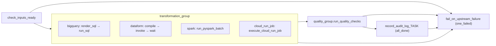

# Bronze → Silver: configurable transformation engines

**Status:** proposal + working prototype (ani-labs). **Scope:** `elementl-nse-core-apps` (orchestration) and `bronze-to-silver` (engine payloads). **Owner:** UDP platform.

Source of truth: `bronze-to-silver/docs/DESIGN.md`; test plan and live results: `bronze-to-silver/docs/TEST\_RESULTS.md`; engine contract: `bronze-to-silver/docs/CONVENTIONS.md`.

## 1. Problem

Source → bronze ingestion in UDP is already engine-configurable: a YAML in `apps/udp/configs/sources/**` picks Cloud Run or Dataflow and the DAG factory wires the rest. Bronze → silver is not. Today it is a fixed `dataform_group` bolted onto the end of every ingestion DAG:

- the engine is hard-wired to Dataform (`gcp-dataform-transformations` repo, tag = bronze table name);
- a silver model can only run as the tail of *one* ingestion DAG, so joins across several bronze tables, aggregates, SCD2 history or anything that needs Python/Spark have no natural home;
- the transformation inherits the ingestion DAG's schedule, retries and failure semantics;
- transformations cannot be re-run, back-filled or tested independently of extraction.

Teams also need freedom of engine: pure SQL (BigQuery), SQL-with-lineage (Dataform), distributed Python (Spark), and arbitrary containers (Cloud Run Jobs) each have workloads where they are the right tool.

## 2. Goals / non-goals

| Goals | Non-goals |
|---|---|
| One YAML per silver table, engine chosen by a single key | Replacing the existing ingestion DAGs or their Dataform tail (kept, untouched) |
| Same DAG shape, audit row, quality gate and failure semantics for every engine | A new scheduler or metadata service |
| Engine payloads versioned and testable offline, deployed per environment | Gold layer (same design applies later, but out of scope now) |
| Zero hard-coded project ids (works in labs / stg / prod from the same files) | Cross-engine lineage graph (Dataform gives it inside its own engine only) |
| Backward compatible: existing `configs/sources/**` behave exactly as before | |

## 3. Architecture

```mermaid
flowchart LR
  subgraph coreapps["elementl-nse-core-apps (orchestration)"]
    Y["configs/transformations/system/table.yaml"] --> F["udp_dag_factory.py - discover + delegate"]
    F --> E["udp_silver_engines.py - engine switch"]
  end
  subgraph b2s["bronze-to-silver (engine payloads)"]
    SQL["bigquery/sql/*.sql"]
    DF["dataform/ (project root)"]
    SP["spark/jobs/*.py + lib/"]
    CR["cloud-run-jobs/silver-transform (image)"]
  end
  E -->|BigQueryInsertJobOperator| BQ[(BigQuery)]
  E -->|Dataform compile+invoke| DFS[Dataform service]
  E -->|DataprocCreateBatchOperator| DP[Dataproc Serverless]
  E -->|CloudRunExecuteJobOperator| CRJ[Cloud Run Job]
  SQL -.deploy/bigquery.sh.-> GCS[(gs://bkt-PROJECT-udp-configs/silver/)]
  SP -.deploy/spark.sh.-> GCS
  CR -.deploy/cloud_run.sh.-> AR[(Artifact Registry)]
  DF -.deploy/dataform.sh / git.-> DFS
  GCS --> BQ
  BQ & DFS & DP & CRJ --> SILVER[(elementl_silver)]
  BRONZE[(elementl_bronze)] --> BQ & DFS & DP & CRJ
```

### 3.1 Fixed DAG shape

Every transformation config becomes `dag_udp_<task_id>` with the same five stages; only the middle differs per engine.



| Stage | What it does | Why |
|---|---|---|
| `check_inputs_ready` | `get_table` on every `inputs[]`; fails if missing (or empty when `inputs_must_have_rows`) | Fail in seconds, not after a 5-minute Spark cold start |
| `transformation_group` | Engine-specific operators (§4) | The only engine-dependent piece |
| `quality_group` | `COUNT(*)` of the output (pushed as XCom) + every `quality.checks[]` SQL; scalar must equal `expect` (default 0) | Same gate for every engine, declared next to the table, independent of the engine's own assertions |
| `record_audit_log_<task>` | One row in `ds_operations.ingestion_execution_logs` with `engine_type = <engine>`, `records_loaded` = output rows, `target_dataset/table` = output | Same table and columns ops already dashboards for ingestion |
| `fail_on_upstream_failure` | Reused from the ingestion factory | Audit task must be `all_done`; this leaf turns the DagRun red |

### 3.2 Parameter contract

All engines receive the same six values plus free-form `params`. This is what makes the engine swappable without touching the YAML schema.

| Parameter | BigQuery SQL | Spark arg | Cloud Run env | Dataform var |
|---|---|---|---|---|
| project | `${project}` | `--project` | `GCP_PROJECT` | `udp_project` |
| bronze dataset | `${bronze_dataset}` | `--bronze-dataset` | `BRONZE_DATASET` | `bronze_dataset` |
| silver dataset | `${silver_dataset}` | `--silver-dataset` | `SILVER_DATASET` | `silver_dataset` |
| logical date | `${ds}` | `--ds` | `EXECUTION_DATE` | `ds` |
| run id | `${run_id}` | `--run-id` | `RUN_ID` | `run_id` |
| output table (FQ) | `${output}` | `--output-table` | `OUTPUT_TABLE` | *(declared in the model)* |
| `transformation.params` | `${params.<k>}` | `--params '<json>'` | `PARAMS` (JSON) | each key as a var |

Placeholders are `${...}` on purpose: the factory passes strings through Airflow Jinja, so `{{ }}` in engine SQL would be mangled. Rendering fails loudly on an unresolved placeholder (typo in YAML → task fails before BigQuery is called).

Every silver table carries `_silver_loaded_at TIMESTAMP` and `_silver_run_id STRING`; the quality template asserts they are populated. Full rules: [CONVENTIONS.md](CONVENTIONS.md).

## 4. Engines

| Engine | Operator(s) | Payload lives in | Deployed to | Use when |
|---|---|---|---|---|
| `bigquery` | `PythonOperator` (read + render SQL at run time) → `BigQueryInsertJobOperator` (deferrable, multi-statement script OK) | `bronze-to-silver/bigquery/sql/<table>.sql` | `gs://bkt-<proj>-udp-configs/silver/bigquery/sql/` | Set-based SQL: MERGE / SCD / partition overwrite / quarantine. Cheapest, fastest, no cluster. Default choice. |
| `dataform` | `DataformCreateCompilationResultOperator` (workspace **or** git commitish) → `DataformCreateWorkflowInvocationOperator` → `DataformWorkflowInvocationStateSensor` | `bronze-to-silver/dataform/` (a Dataform project root) | Dataform repository `bronze-to-silver` (git-connected in CI envs; workspace `labs` uploaded by `deploy/dataform.sh` in labs) | Many related SQL models with `ref()` lineage, built-in assertions, incremental tables. Pick when a *family* of tables is maintained together. |
| `spark` | `DataprocCreateBatchOperator` (Serverless, runtime 2.2, deferrable) | `bronze-to-silver/spark/jobs/<job>.py` + `spark/lib/udp_silver_common.py` | `gs://bkt-<proj>-udp-configs/silver/spark/{jobs,lib}/` | Distributed Python: windows over very large facts, UDF-heavy logic, ML features, iterative algorithms (hierarchies), anything that outgrows SQL. ~3–5 min cold start. |
| `cloud_run_job` | `CloudRunExecuteJobOperator` (deferrable), transform picked by `TRANSFORM` env | `bronze-to-silver/cloud-run-jobs/silver-transform/transforms/<name>.py` | Artifact Registry image + Cloud Run Job `silver-transform` | Arbitrary libraries (pandas, external APIs, calendar maths, statistics) on small/medium data; one container for many transforms. ~10–30 s start. |

Engine selection rules of thumb: **SQL first** (BigQuery), **Dataform when you want lineage and assertions across many SQL models**, **Cloud Run when you need Python but the data fits in memory**, **Spark when it doesn't**.

### 4.1 Engine specifics

- **BigQuery** — `sql_file` (gs:// or path relative to the YAML), `sql_files` (concatenated into one script) or inline `sql`. The job runs in `GCP_REGION` with labels `udp_layer=silver, udp_engine=bigquery, udp_task=<task>`. BigQuery scripting rule: `DECLARE` must precede any other statement (enforced by an offline test).
- **Dataform** — `code_compilation_config.default_schema` = silver dataset, `assertion_schema` = `<silver>_assertions` by default, vars = contract + `params` + `dataform.vars`. `included_tags` defaults to the output table name. Dataform's strict act-as check requires `service_account`; the factory defaults it to `DATAFORM_SERVICE_ACCOUNT`, else the Composer worker SA (metadata server). The Dataform service agent needs `roles/iam.serviceAccountTokenCreator` on that SA. `compilation_result` is templated, so `run_id`/`ds` vars resolve per run.
- **Spark** — batch body built by `build_spark_batch`; `subnetwork` must have Private Google Access; `service_account` defaults to `SPARK_SERVICE_ACCOUNT` else the worker SA; `batch_id` is left to Dataproc (unique) and the batch is labelled with `udp_task`. Extra `args`/`properties` are appended.
- **Cloud Run Job** — env contract + `TASK_ID` + any `cloud_run_job.env`; `timeout_seconds` → `overrides.timeout`. One image, `transforms/<TRANSFORM>.py` registry.

## 5. Config schema

Full annotated reference: `apps/udp/configs/transformations/_template_transformation_reference.yaml`. Minimal example:

```yaml
template: transformation_task_metadata
pipeline: transformation
task_id: silver_stg_netsuite_customer
source_system: netsuite
inputs:
  - {bq_dataset: elementl_bronze, bq_table: netsuite_customer}
output:
  bq_project: ${GCP_PROJECT_ID}
  bq_dataset: elementl_silver
  bq_table: stg_netsuite_customer
transformation:
  engine: bigquery            # bigquery | dataform | spark | cloud_run_job
  scenario: scd1_merge_incremental
  params: {}
  bigquery:
    sql_file: "gs://bkt-${GCP_PROJECT_ID}-udp-configs/silver/bigquery/sql/stg_netsuite_customer.sql"
quality:
  min_rows: 1
  checks:
    - {name: unique_id, sql: "SELECT COUNT(*) - COUNT(DISTINCT id) FROM `${output}`"}
orchestration: {schedule: "@daily", retries: 0, active: true}
```

Discovery: `discover_all_configs()` now scans `configs/sources/**` **and** `configs/transformations/**` (local Composer bucket first, then GCS). Transformation YAMLs are bucketed per engine: `configs/transformations/<system>/{bigquery,dataform,spark,cloud_run_job}/<table>.yaml`; the folder is purely organisational — `transformation.engine` inside the file is authoritative and discovery is recursive. A config is a transformation when `pipeline: transformation` or `template: transformation_task_metadata`; everything else follows the unchanged ingestion path. `task_id`s must be unique across both trees (unit-tested).

## 6. Repository strategy — recommendation

**Recommendation: two repositories.** Keep orchestration in `elementl-nse-core-apps`; put *all four engines' payloads* in one new repo, `bronze-to-silver`, organised per engine. Retire `gcp-dataform-transformations` into `bronze-to-silver/dataform/` once the Dataform repository's git connection is re-pointed (see trade-offs).

| Option | Pros | Cons | Verdict |
|---|---|---|---|
| **A. Everything in `elementl-nse-core-apps`** | One PR touches YAML + SQL + factory; single CI | Repo already carries Terraform, Cloud Run images, Composer DAGs; Spark/Dataform/BQ SQL would triple the tree and every SQL edit triggers the full infra pipeline (`udp-stg-infra-plan` deploys Composer on PR to main). Dataform git connections need a repo **root**, impossible in a sub-folder. | ✗ |
| **B. One repo per engine (4 repos + existing Dataform)** | Each team owns its toolchain; Dataform gets its root | 5 places to look for "how is table X built"; conventions drift; cross-engine changes (e.g. renaming a bronze column) need 5 PRs; audit/quality glue duplicated | ✗ |
| **C. Orchestration repo + one `bronze-to-silver` repo (per-engine folders)** ✅ | Single place for *all* silver logic, shared `CONVENTIONS.md`, one test runner, one scenario catalogue; orchestration contract (YAML) stays with the factory that interprets it; `dataform/` is a project root in its own right (Dataform can point at the repo with directory `dataform/`? — see note) | Two PRs when a new table needs both a YAML and a payload (mitigated: YAML is 30 lines and references artefacts by URI, so payload can ship first); Dataform git connection must either point at a repo whose root is `dataform/` or Dataform's *subdirectory* setting must be used | ✅ |

> **Note:** Dataform's GitHub connection supports a **"default branch" and a "repository root directory"**? It does not today: the connection compiles from the repo root. Two workable paths: (1) keep `gcp-dataform-transformations` as the git-connected repo for *ingestion-tail* models and make `bronze-to-silver/dataform/` the source that `deploy/dataform.sh` pushes into a Dataform **workspace** (what labs does; also fine for CI by pushing to a workspace per environment); (2) split `bronze-to-silver/dataform/` out as its own git repo later if a git-connected Dataform repository is a hard requirement. The YAML already supports both (`workspace:` vs `git_commitish:`), so this choice does not affect the orchestrator.

Ownership and CI per repo:

| Repo | Contains | CI |
|---|---|---|
| `elementl-nse-core-apps` | `udp_dag_factory.py`, `udp_silver_engines.py`, `configs/transformations/**`, unit tests, Composer deploy | existing Cloud Build (`udp-stg-infra-*`), + `pytest tests/unit` (configs must resolve; no hard-coded projects; all engines covered) |
| `bronze-to-silver` | `bigquery/`, `dataform/`, `spark/`, `cloud-run-jobs/`, `tests/`, `deploy/`, `docs/`, `testdata/` | per-folder offline tests on PR; on merge: `deploy/bigquery.sh` + `deploy/spark.sh` (GCS), `deploy/cloud_run.sh` (image + job), `deploy/dataform.sh push` (workspace) — each parameterised by project |

## 7. Deployment & environments

- Artefact bucket per project: `gs://bkt-<project>-udp-configs/silver/...`; configs reference it as `gs://bkt-${GCP_PROJECT_ID}-udp-configs/...` and the factory substitutes the project. **No project id appears in any committed file** (guarded by a unit test).
- Composer: the factory + module + `configs/transformations/` are synced to the `dags/` folder exactly like `configs/sources/` today (same Cloud Build step).
- Environment knobs (Composer env vars): `GCP_REGION`, `DATAFORM_REPOSITORY`, `DATAFORM_GIT_COMMITISH`, `DATAFORM_SERVICE_ACCOUNT`, `SPARK_SUBNETWORK`, `SPARK_SERVICE_ACCOUNT`, `UDP_RUNTIME_SERVICE_ACCOUNT`, `ENABLE_DAG_SCHEDULE`.
- IAM (runtime SA = Composer worker SA unless overridden): BigQuery `dataEditor` + `jobUser` on bronze/silver, `dataproc.worker`, `storage.objectViewer` on the artefact bucket, `run.invoker`/`run.developer` for the job, Dataform `editor`; Dataform service agent needs `iam.serviceAccountTokenCreator` on the runtime SA; Spark/Cloud Run SAs need BigQuery write + GCS temp bucket.

## 8. Testing strategy

| Level | Where | What |
|---|---|---|
| Offline unit | `core-apps/tests/unit/test_udp_silver_engines.py` | spec builders per engine, placeholder rendering, discovery, every live YAML resolves and covers all four engines |
| Offline per engine | `bronze-to-silver/tests/{bigquery,dataform,spark,cloud_run}` | SQL placeholder discipline + DECLARE order; Dataform project structure; Spark transforms on local SparkSession; Cloud Run transforms on pandas fixtures |
| Integration (labs) | `testdata/seed_bronze.sql` → 16 synthetic bronze tables, several versions per id, dirty values | run each engine's payload directly (`deploy/*.sh`, `bigquery/render.py`) |
| End-to-end (labs) | 20 DAGs in Composer, 2 at a time | DAG shape, quality gate, audit rows, idempotent re-runs |

## 9. Scenario catalogue (20 tables, 5 per engine)

| # | Output table | Engine | Scenario | Inputs |
|---|---|---|---|---|
| 1 | `stg_netsuite_customer` | bigquery | SCD1 MERGE, incremental on bronze watermark | customer |
| 2 | `dim_netsuite_vendor_history` | bigquery | SCD2 history (valid_from/valid_to/is_current) | vendor |
| 3 | `stg_netsuite_subsidiary` | bigquery | JSON flatten, full rebuild | subsidiary |
| 4 | `stg_netsuite_entity` | bigquery | Partition overwrite with look-back (`params.lookback_days`) | entity |
| 5 | `stg_netsuite_location` | bigquery | Quality quarantine → `rej_netsuite_location` | location |
| 6 | `stg_netsuite_account` | dataform | Dedupe + cast, assertions | account |
| 7 | `stg_netsuite_transaction` | dataform | Incremental merge (`uniqueKey`) | transaction |
| 8 | `fct_netsuite_transaction_lines` | dataform | Join fact with `ref()` lineage, partitioned | transactionline, transaction |
| 9 | `agg_netsuite_posting_daily` | dataform | Aggregate over the fact | (via 8) |
| 10 | `stg_netsuite_budgets_monthly` | dataform | Unpivot 12 amount columns | budgets |
| 11 | `fct_netsuite_account_running_balance` | spark | Window running total | transactionline, transaction |
| 12 | `stg_netsuite_item_tags` | spark | Split + explode | item |
| 13 | `stg_netsuite_employee` | spark | PII masking (`params.salt`) | employee |
| 14 | `fct_netsuite_transaction_usd` | spark | As-of currency-rate join | transaction, currencyrate |
| 15 | `dim_netsuite_classification_path` | spark | Hierarchy path flattening | classification |
| 16 | `dim_netsuite_fiscal_calendar` | cloud_run_job | Calendar generation | accountingperiod |
| 17 | `stg_netsuite_address_enriched` | cloud_run_job | Enrichment with lookups | address |
| 18 | `stg_netsuite_customer_domains` | cloud_run_job | String parsing / classification | customer |
| 19 | `fct_netsuite_transaction_anomalies` | cloud_run_job | Z-score outliers (`params.z_threshold`) | transaction |
| 20 | `fct_netsuite_budget_vs_actual` | cloud_run_job | Multi-input reconciliation | budgets, transactionline, transaction, accountingperiod |

Results of the labs run are in [TEST_RESULTS.md](TEST_RESULTS.md).

## 9a. Validation status (ani-labs, 2026-10-07)

| Level | Result |
|---|---|
| Offline tests, engine payloads (`bronze-to-silver/tests`) | 130 passed, 1 skipped |
| Offline tests, orchestrator (`tests/unit/test\_udp\_silver\_engines.py`) | 10 passed; ingestion suite unchanged |
| Direct engine runs (all 20 tables) | 20 / 20 built, keys unique, idempotent re-runs confirmed |
| Composer end-to-end (20 DAGs, 2 at a time) | in progress: BigQuery 5/5 and Dataform 3/5 green, Spark and Cloud Run queued |

Issues found so far are all resolved (BigQuery `DECLARE` ordering, Dataform strict act-as service account, Spark `readSessionUser`, Dataproc CPU quota → max 2 concurrent, one Composer stuck-queued incident). Details in TEST\_RESULTS.md.

## 10. Rollout plan

1. **Labs** (done): seed bronze, run all four engines directly, then the 20 DAGs through Composer.
2. **Staging**: merge factory + module + a first `configs/transformations/netsuite/<engine>/` set on a feature branch; deploy `bronze-to-silver` artefacts with the project parameter; Dataform via `git_commitish` once the repository connection decision (§6 note) is made.
3. **Migrate the ingestion tail**: for each bronze table whose Dataform model moves to a transformation config, set `orchestration.dataform.enabled: false` on the ingestion YAML. Ingestion DAGs then end at bronze; the silver DAG is triggered on its own schedule (or by a dataset/`TriggerDagRunOperator` hop — see open questions).
4. **Prod**: same artefacts, project-substituted.

## 11. Open questions

- **Dependency between ingestion and transformation DAGs**: cron offset (simple, what the prototype uses) vs Airflow Datasets / `TriggerDagRunOperator` from the ingestion DAG (tighter, more coupling). Recommendation: start with schedules, add an optional `orchestration.depends_on: [dag_udp_netsuite_customer]` that compiles to an `ExternalTaskSensor` when needed.
- **Dataform git connection** for `bronze-to-silver/dataform/` (§6 note).
- **Spark cost/latency**: Dataproc Serverless cold start dominates small jobs; consider a long-lived session template for sub-minute tables, or route them to Cloud Run.
- **Per-engine quality**: Dataform assertions already fail the invocation; the factory's `quality_group` runs again — acceptable duplication (cheap) or skip when engine = dataform?
- **Schema contract**: silver column contracts (types, nullability) could be declared in YAML and validated post-run; deferred until the schema-contract design (separate doc) lands.
